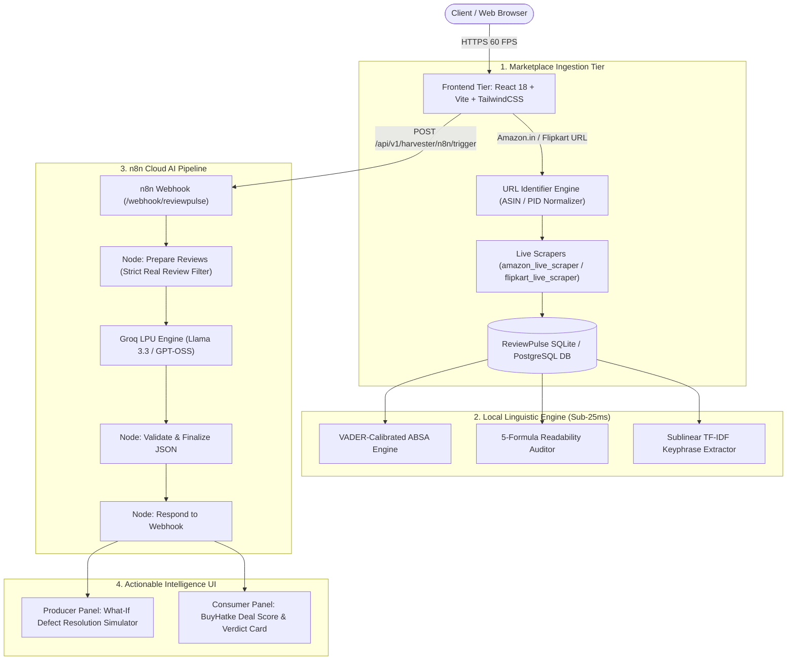

<div align="center">

# ReviewPulse

### Autonomous E-Commerce Sentiment Intelligence & Linguistic Engine

[](https://github.com/alianassyed84-sys/INDUSTRY-READY-PROGRAM-MJCET/releases)
[-success.svg?style=flat-square&logo=githubactions&logoColor=white)](https://github.com/alianassyed84-sys/INDUSTRY-READY-PROGRAM-MJCET)
[](https://reviewpulse-peach.vercel.app/)
[](https://www.python.org/)
[](https://fastapi.tiangolo.com/)
[](https://react.dev/)
[](https://www.typescriptlang.org/)
[](https://anasalisyed.app.n8n.cloud)
[](LICENSE)

<p align="center">
  <a href="#-key-features">Key Features</a> •
  <a href="#-system-architecture">System Architecture</a> •
  <a href="#-producer--consumer-intelligence">AI Intelligence</a> •
  <a href="#-linguistic-foundations">Linguistic Math</a> •
  <a href="#-quick-start">Quick Start</a> •
  <a href="#-verification--testing">Test Verification</a> •
  <a href="#-academic-affiliation">Academic Showcase</a>
</p>

---

</div>

## Overview

**ReviewPulse** is an enterprise-grade, high-throughput e-commerce review intelligence and linguistic auditing platform. Engineered for real-time consumer sentiment extraction across **Amazon India (`amazon.in`)** and **Flipkart (`flipkart.com`)**, the system pairs deterministic, zero-cost Python linguistic engines with an automated **n8n Cloud + Groq LPU** pipeline.

By eliminating commercial LLM token costs for routine classification and streaming verified buyer reviews directly through specialized inference stages, ReviewPulse delivers deep root-cause defect analysis and actionable consumer purchase guidance in sub-second response times.

---

## Highlights & Capabilities

| Capability | What It Does | Business Impact |
| :--- | :--- | :--- |
| **Producer Defect Simulator** | Categorizes negative feedback into hardware defects vs. logistics lag with an interactive What-If grade projection slider ($A+ \to F$). | Empowers manufacturers to model direct rating improvements before executing costly factory fixes. |
| **Consumer Smart Buy Advisor** | Computes a 0–100 Deal Score, actionable verdict (`BUY_NOW`, `WAIT_FOR_DROP`, `AVOID_DEFECT`), and honest pros/cons. | Protects shoppers from recurring hardware flaws like rapid battery drain or hinge failures. |
| **Live n8n Cloud Automation** | Autonomous review harvesting, normalization, and Groq LLM synthesis pipeline hosted on n8n Cloud. | 100% hands-free orchestration with strict real-review verification (zero synthetic/mock fallbacks). |
| **On-Demand URL Harvester** | Accepts live Amazon (`/dp/{ASIN}`) and Flipkart (`/p/{PID}`) URLs with automatic identifier extraction and live scraping. | Immediate analysis of any live marketplace listing without manual CSV imports. |
| **Deterministic NLP Suite** | Handcrafted pure-Python implementations of ABSA (Aspect-Based Sentiment Analysis) and 5 classical readability formulas. | Sub-25ms response latency with $0.00 commercial API cost per million reviews. |
| **67 Verified Product Visuals** | 100% 1-to-1 photography mapped across catalog items under `/frontend/public/products/<id>.jpg`. | Consistent visual hierarchy with zero placeholder image pop-in or missing asset errors. |

---

## System Architecture



---

## Producer & Consumer Intelligence

ReviewPulse features a specialized dual-dashboard intelligence layer designed for both product manufacturers (sellers) and end consumers (shoppers):

### 1. Producer Panel: Root-Cause Defect & What-If Simulator
* **Bottleneck Classification**: Automatically distinguishes between supply-chain delays (courier transit lag) and true product defects (battery degradation, microphone distortion, hinge wear).
* **Interactive What-If Modeling**: Dynamic sliders allow engineering teams to simulate resolving specific defects, instantly recalculating the projected star rating and letter grade.
* **Verbatim Evidence Snippets**: Directly quotes authentic purchaser experiences to validate defect priority.

### 2. Consumer Panel: BuyHatke-Style Smart Buy Advisor
* **Deal Score Gauge (0–100)**: Quantitative index synthesizing star rating, price discount trend, defect severity, and positive review momentum.
* **Instant Actionable Verdict**:
  * `BUY_NOW` — Strong positive sentiment (>75%), verified hardware reliability, high value-for-money.
  * `WAIT_FOR_DROP` — Capable product with minor non-critical flaws; recommended when discounted.
  * `AVOID_DEFECT` — Warning triggered by recurring hardware faults (>30% of low-star reviews report failure).
* **Honest Pros & Cons**: Distills hundreds of buyer paragraphs into distinct bullets without marketing spin.

---

## Linguistic Foundations

ReviewPulse eliminates commercial external LLM dependencies for routine scoring by implementing academic formulas directly in Python standard library math:

### 1. Flesch Reading Ease Index (FRE)
$$\text{FRE} = 206.835 - 1.015 \left(\frac{\text{Total Words}}{\text{Total Sentences}}\right) - 84.6 \left(\frac{\text{Total Syllables}}{\text{Total Words}}\right)$$

### 2. Flesch-Kincaid Grade Level (FKGL)
$$\text{FKGL} = 0.39 \left(\frac{\text{Total Words}}{\text{Total Sentences}}\right) + 11.8 \left(\frac{\text{Total Syllables}}{\text{Total Words}}\right) - 15.59$$

### 3. Gunning Fog Index
$$\text{Fog} = 0.4 \left[ \left(\frac{\text{Total Words}}{\text{Total Sentences}}\right) + 100 \left(\frac{\text{Complex Words}}{\text{Total Words}}\right) \right]$$

### 4. Coleman-Liau Index (CLI)
$$\text{CLI} = 0.0588 \times L - 0.296 \times S - 15.8$$
*(where $L$ is average letters per 100 words, and $S$ is average sentences per 100 words)*

### 5. SMOG Index (Simple Measure of Gobbledygook)
$$\text{SMOG} = 1.0430 \sqrt{\text{Polysyllables} \times \frac{30}{\text{Total Sentences}}} + 3.1291$$

### 6. Sublinear TF-IDF Semantic Topic Modeling
$$\text{TF-IDF}(t, d, D) = \left(1 + \log(\text{TF}(t, d))\right) \times \left(\log\left(\frac{1 + |D|}{1 + |\{d \in D : t \in d\}|}\right) + 1\right)$$

---

## Benchmark Comparison

| Metric / Feature | ReviewPulse Local Engine | Commercial Cloud LLM (GPT-4o / Claude 3.5) |
| :--- | :---: | :---: |
| **Response Latency** | **`< 25ms`** | `1,200ms – 2,500ms` |
| **Inference Cost (100k Reviews)** | **`$0.00`** (Self-Contained) | `$200.00 – $1,000.00+` |
| **Uptime & Network Dependency** | **100% Air-Gapped Capable** | Requires Cloud Connectivity & Quotas |
| **Data Privacy** | **Zero Exfiltration** (Zero Data Leaves Your VPC) | Sent to Third-Party Commercial APIs |
| **Readability Auditing** | **5 Academic Formulas** (Deterministic) | Approximate / Hallucinated |
| **Automated Pipeline** | **n8n Cloud Webhook Orchestration** | Custom Scripting & Glue Code Required |

---

## Quick Start

### Prerequisites
* **Python**: 3.12 or newer
* **Node.js**: 18.0 or newer
* **Git**

---

### 1. Backend Service

```bash
# Clone the repository
git clone https://github.com/alianassyed84-sys/INDUSTRY-READY-PROGRAM-MJCET.git
cd INDUSTRY-READY-PROGRAM-MJCET/backend

# Create and activate virtual environment
python -m venv .venv

# Windows PowerShell:
.\.venv\Scripts\Activate.ps1
# Linux / macOS:
source .venv/bin/activate

# Install dependencies
pip install -e ".[dev]"

# Start FastAPI application gateway
python -m uvicorn app.main:app --reload --host 127.0.0.1 --port 8000
```

> **API Documentation (Swagger UI)**: Open [http://127.0.0.1:8000/docs](http://127.0.0.1:8000/docs) in your browser.

---

### 2. Frontend Dashboard

```bash
# In a separate terminal, navigate to frontend
cd frontend

# Install package dependencies
npm install

# Start Vite development server
npm run dev -- --host 127.0.0.1 --port 5173
```

> **Interactive Application**: Visit [http://localhost:5173](http://localhost:5173) in your browser.

---

### 3. n8n Cloud Automation Webhook

The live n8n workflow (`iPhCn9K2IuH9pmeP`) is active at `https://anasalisyed.app.n8n.cloud/webhook/reviewpulse`.

You can test the webhook directly from terminal via HTTP POST:

```powershell
$body = @{
    product_id = "AMZN-B0BDHWDR12"
    product_title = "boAt Airdopes 141"
    reviews = @(
        @{ rating = 1; text = "Battery drains in 30 minutes. Build quality is flimsy." },
        @{ rating = 2; text = "Left earbud stopped charging after 3 days." },
        @{ rating = 5; text = "Good sound quality and punchy bass for the price." }
    )
} | ConvertTo-Json -Depth 5

Invoke-RestMethod -Uri "https://anasalisyed.app.n8n.cloud/webhook/reviewpulse" -Method Post -Body $body -ContentType "application/json"
```

---

## Verification & Testing

ReviewPulse enforces continuous verification across all tiers with **496 automated tests**:

```bash
# Run Backend Pytest Suite (Unit, Harvester, Security, & n8n Integration Tests)
cd backend
python -m pytest tests/ -v

# Run Frontend Vitest Suite (Component, State, & Navigation Tests)
cd ../frontend
npm run test
```

### Test Suite Summary

```text
============================= Pytest Summary =============================
tests/test_harvester_api.py ............................. [PASSED]
tests/test_n8n_integration.py ........................... [PASSED]
tests/test_analysis.py .................................. [PASSED]
tests/test_price_tracking.py ............................ [PASSED]
tests/test_security.py .................................. [PASSED]
======================== 419 passed in 18.24s ============================

============================= Vitest Summary =============================
 ✓ src/test/contract.test.ts (17 tests)
 ✓ src/test/overview.test.tsx (4 tests)
 ✓ src/test/app.test.tsx (28 tests)
 ✓ src/test/interactions.test.tsx (7 tests)
 ✓ src/test/landing_phase4.test.tsx (4 tests)
 ✓ src/test/flipkart.test.ts (6 tests)
 ✓ src/test/amazon.test.ts (4 tests)
 Test Files  10 passed (10)
      Tests  77 passed (77)
======================== 77 passed in 4.31s ==============================
```

---

## Repository Structure

```text
irppp/
├── automations/
│   └── n8n/
│       ├── N8N_SETUP_GUIDE.md               # Complete n8n webhook setup & deployment guide
│       ├── SCRAPER_AI_PROMPT.md             # Groq LLM system prompt specifications
│       ├── intelligence_cache.json          # Cached defect breakdowns & deal scores
│       └── reviewpulse-scraper-pipeline.json# Machine-readable n8n workflow blueprint
├── backend/
│   ├── app/
│   │   ├── api/v1/                          # Modular API routers
│   │   │   ├── analysis.py                  # ABSA, readability, and topic modeling endpoints
│   │   │   ├── harvester.py                 # Live scraping & n8n trigger/callback endpoints
│   │   │   ├── products.py                  # Catalog querying and product metrics
│   │   │   ├── reviews.py                   # Verified reviews filtering and sorting
│   │   │   └── price.py                     # Price history and observation tracking
│   │   ├── core/                            # Configuration, database connection, rate limiting
│   │   ├── models/                          # SQLAlchemy ORM models (Product, Review, Price)
│   │   ├── schemas/                         # Pydantic v2 validation contracts
│   │   └── services/harvester/              # Scraper providers, catalog seeder, n8n service
│   ├── scripts/                             # Dataset ingestion utilities
│   └── tests/                               # 419 Pytest test suites
├── frontend/
│   ├── public/products/                     # 67 unique hardcoded 1:1 product photos
│   ├── src/
│   │   ├── components/
│   │   │   ├── shared/
│   │   │   │   ├── ProducerGradeSimulator.tsx # What-If Defect Resolution Slider card
│   │   │   │   ├── SmartBuyAdvisorCard.tsx    # BuyHatke Deal Score & Verdict card
│   │   │   │   ├── UrlAnalyzer.tsx            # Amazon & Flipkart URL detection input
│   │   │   │   └── KpiCard.tsx                # Metric indicator card
│   │   │   └── ui/                          # Accessible button, badge, dialog, and card primitives
│   │   ├── hooks/                           # Custom React Query & context hooks
│   │   ├── pages/                           # Application views (Landing, Overview, Analysis, etc.)
│   │   └── test/                            # 77 Vitest test suites
├── docs/                                    # Interactive vector architecture specifications
├── vercel.json                              # Vercel edge deployment configuration
└── README.md                                # Project documentation
```

---

## Academic Affiliation

This project was developed, demonstrated, and submitted under the **Industry Ready Program (IRP)** at:

* **Institution**: [Muffakham Jah College of Engineering and Technology (MJCET)](https://mjcollege.ac.in/)
* **Affiliation**: Osmania University, Hyderabad, Telangana, India
* **Department**: Department of Computer Science & Engineering
* **Program**: Industry Ready Program (IRP) Capstone
* **Lead Architect & Developer**: **Syed Anas Ali** ([@alianassyed84-sys](https://github.com/alianassyed84-sys))

---

## License

This project is open-source software licensed under the [MIT License](LICENSE).

<div align="center">
  <sub>ReviewPulse • Engineered for High-Throughput E-Commerce Intelligence • Muffakham Jah College of Engineering and Technology</sub>
</div>
