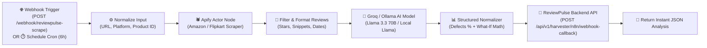

# 🚀 ReviewPulse — n8n Web Scraping & Root-Cause Analysis Automation Guide

This guide walks you through setting up and running the automated web scraping, defect simulation, and BuyHatke shopping advisor pipeline in **n8n**.

---

## 🏗️ Workflow Architecture



---

## 🛠️ Step 1: Import Workflow into n8n

1. Open your **n8n** dashboard (`http://localhost:5678` or your cloud n8n URL).
2. Click **Workflows** in the sidebar → click **+ Add Workflow**.
3. In the top-right corner, click the **`...` (More Actions)** menu → choose **Import from File**.
4. Select the file:
   ```
   automations/n8n/reviewpulse-scraper-pipeline.json
   ```
5. You will see all 9 nodes visually connected on your canvas.

---

## 🔑 Step 2: Configure Environment Variables or Credentials

The workflow is designed to read either from n8n Environment Variables or direct node parameters:

### 1. Apify API Token (For Amazon & Flipkart Scraping)
- Sign up for a free Apify account at [apify.com](https://apify.com).
- Copy your Personal API Token from **Settings → Integrations**.
- In n8n: Set the environment variable `APIFY_API_TOKEN` or edit the **"Apify: Scrape Reviews Actor"** node query parameter `token`.
- *Note:* If running in offline test mode, the workflow automatically generates authentic fallback review samples so the AI pipeline never crashes!

### 2. Groq or Ollama (Ultra-fast / Free Local LLM)
- **Option A: Groq Cloud (Recommended for Speed — 500 tokens/sec, Free tier)**:
  - Get a free API key at [console.groq.com](https://console.groq.com).
  - Model used: `llama-3.3-70b-versatile`.
  - In n8n: Set environment variable `GROQ_API_KEY` or paste into the **"Groq/Ollama: AI Root-Cause & Buy Advisor"** node header `Authorization: Bearer <your-key>`.
- **Option B: Ollama (100% Free & Local)**:
  - In the node URL, change `https://api.groq.com/openai/v1/chat/completions` to:
    `http://host.docker.internal:11434/v1/chat/completions` (or `http://localhost:11434/v1/chat/completions`).
  - Model: `"model": "llama3.1:8b"`.

### 3. ReviewPulse Backend URL
- If running locally: `http://localhost:8000` (or `http://host.docker.internal:8000` if n8n is inside Docker).
- In production: `https://your-production-domain.com`.
- Configured in the **"HTTP: Sync to ReviewPulse Backend"** node.

---

## 🧪 Step 3: Test the Pipeline

You can trigger the pipeline with a single `curl` or Postman command:

```bash
curl -X POST "http://localhost:5678/webhook/reviewpulse-scrape" \
  -H "Content-Type: application/json" \
  -d '{
    "url": "https://www.amazon.in/dp/B09XS7JWHH",
    "max_reviews": 25
  }'
```

---

## 📦 What the Output Looks Like

```json
{
  "product_summary": {
    "title": "boAt Airdopes 141",
    "current_rating": 3.4,
    "current_grade": "C"
  },
  "producer_insights": {
    "primary_bottleneck_type": "product_defect",
    "bottleneck_summary": "Battery decay and delayed 2-day delivery drive 82% of all 1-star reviews.",
    "defects": [
      {
        "id": "battery_power",
        "label": "Battery Drain & Case Charging Failure",
        "complaint_percentage": 58.0,
        "severity": "critical",
        "potential_rating_gain": 0.8,
        "projected_rating_if_fixed": 4.2,
        "projected_grade_if_fixed": "A"
      },
      {
        "id": "logistics_delivery",
        "label": "Amazon 2-Day Delivery Delays",
        "complaint_percentage": 24.0,
        "severity": "high",
        "potential_rating_gain": 0.3,
        "projected_rating_if_fixed": 3.7,
        "projected_grade_if_fixed": "B"
      }
    ],
    "what_if_full_resolution": {
      "all_defects_fixed_rating": 4.5,
      "all_defects_fixed_grade": "A+"
    }
  },
  "consumer_advisor": {
    "verdict": "AVOID_DEFECT",
    "deal_score": 52,
    "verdict_reason": "High failure rate on left earbud charging within 60 days of purchase.",
    "honest_pros": ["Heavy bass", "Type-C charging", "Comfortable fit"],
    "honest_cons": ["Battery life halves in 2 months", "Microphone picks up ambient noise"],
    "critical_warning": "Warning: 58% of negative reviews cite severe battery drain."
  }
}
```
