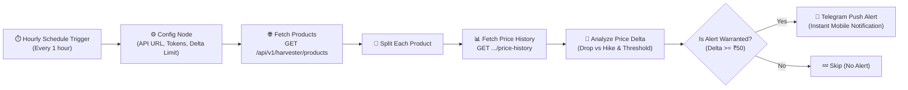

# ReviewPulse Price Alert Automation (n8n + Telegram Mobile)

Automated workflow that polls **ReviewPulse** product price history and delivers instant real-time push notifications to your mobile phone via **Telegram** when prices drop or increase.

---

## ⚡ Architecture Flow



---

## 📱 Sample Notification on Your Mobile

### 🟢 When Price Drops:
```
🟢 PRICE DROP ALERT! 🔥 ALL-TIME LOW!

📦 Apple iPhone 15 (128 GB) - Black
💰 New Price: ₹54,999
Original Price: ₹79,900
🎉 You Save: ₹24,901 (-31.2%)

🆔 Product ID: B0CHX1W1XY
⏰ Updated: 08:30 PM
⚡ Automated by ReviewPulse Neural Engine
```

### 🔴 When Price Increases:
```
🔴 PRICE INCREASE NOTICE!

📦 Sony WH-1000XM5 Wireless Headphones
💰 New Price: ₹29,990
Previous Price: ₹26,990
📈 Increased By: +₹3,000 (+11.1%)

🆔 Product ID: B09XS7JWHH
⏰ Updated: 08:30 PM
⚡ Automated by ReviewPulse Neural Engine
```

---

## 🚀 Quick Setup Guide (Takes 2 Minutes)

### Step 1: Create your Free Telegram Bot (30 Seconds)
1. Open Telegram on your phone or desktop.
2. Search for **`@BotFather`** and open the chat.
3. Send `/newbot`.
4. Enter a name (e.g. `ReviewPulse Price Bot`).
5. Enter a username ending with `bot` (e.g. `my_reviewpulse_bot`).
6. BotFather will give you a **Token** (e.g. `7123456789:AAFx...`). **Save this token!**
7. Click the link to your new bot and tap **START** (Required so the bot can send you messages).

---

### Step 2: Get your Telegram Chat ID (10 Seconds)
1. In Telegram search bar, search for **`@userinfobot`**.
2. Press **START**.
3. It will reply with your details:
   - `Id: 123456789`
4. Copy this number — this is your **`telegramChatId`**.

---

### Step 3: Test Push Notification Instantly (Optional)
Before opening n8n, you can verify that notifications reach your phone:

```powershell
python automations/n8n/test_telegram_alert.py <YOUR_BOT_TOKEN> <YOUR_CHAT_ID>
```
*Your phone will immediately buzz with a test price drop alert and price hike notice!*

---

### Step 4: Start n8n
If you have Node.js installed, simply run in any terminal:

```powershell
npx n8n
```
*n8n will start locally and open in your browser at `http://localhost:5678`.*

---

### Step 5: Import the Workflow
1. In the n8n dashboard, click **Workflows** in the left menu.
2. Click **Add workflow** (or the **`...`** menu in top right) -> **Import from File**.
3. Select `automations/n8n/reviewpulse-price-monitor.json` from this repository.
4. Double-click the **Config** node:
   - Update `telegramBotToken` with your bot token.
   - Update `telegramChatId` with your chat ID.
   - (Optional) Adjust `minPriceDelta` (default is `50`, meaning price changes under ₹50 are ignored to prevent noise).
   - If running against local backend, keep `apiUrl` as `http://localhost:8000`. If testing live Vercel/cloud backend, set to your API host.
5. Click **Test step** or **Execute workflow** to test!
6. Turn the switch at the top right from **Inactive** to **Active**.

Done! Your phone is now linked to ReviewPulse and will automatically alert you whenever prices change!
